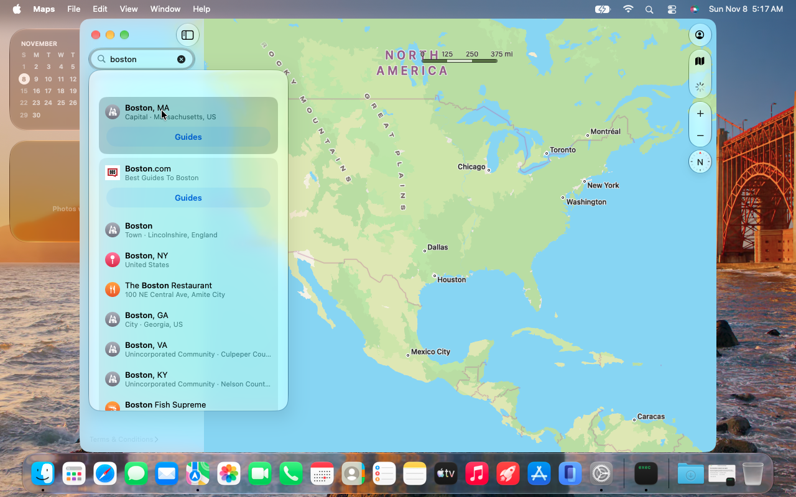

# hao-runtime

hao runs **ARM64 and ARM64e macOS programs on Intel Macs**. It loads ARM Mach-O
executables and libraries, translates their code to x86_64, and connects the
translated code to the native Intel system libraries, so an ARM-only program
calls the same frameworks it would call on Apple silicon.

This repository builds:

- `libhao.dylib`, the runtime: loader, translator, interpreter, AOT cache loader
  and the native call and callback bridge.
- `hao`, the command-line launcher, and `hao-stub`, the x86_64 slice that
  `tools/hao-embed` adds to an ARM-only executable so the kernel can start it
  under its own identity.
- `HaoExec`, a kernel extension that routes the exec of an ARM-only executable
  to `/usr/libexec/hao`.

With these, macOS 27, whose userspace ships ARM-only, boots through Setup
Assistant to the desktop on a **13-inch 2012 MacBook Pro (MacBookPro9,2)**.
The current tested release is 27.2.1 (26B131), which the generated interface
tables describe; 27.0 (26A428) was the earlier target.

## Read first

hao is experimental. Use it only on a **dedicated test machine** whose
contents you can lose, never on a Mac you depend on.

- Installing changes the System volume: it adds `/usr/libexec/hao` and
  `/usr/lib/hao/`, adds an x86_64 slice to Apple's ARM-only executables in
  place, and on 27.x replaces `dyld` with a fixed copy. HaoExec is a kernel
  extension that routes the exec of ARM-only programs to hao.
- The system images that run hao also need reduced platform security (for
  example System Integrity Protection and AMFI relaxed) so that a modified
  System volume and a kernel extension Apple has not signed can load. That is the image
  builder's job, not this repository's, but it applies to any machine running
  hao.
- There is no uninstaller. Deleting hao's files breaks every program it was
  embedded into, which includes launchd. To remove it, restore the System
  volume from a snapshot or reinstall macOS, and drop HaoExec from whatever
  loads it (the boot loader's kext list, or `/Library/Extensions` followed by
  a kernel collection rebuild). `usr/lib/hao/install.json` records what an
  install wrote.



## Status

Experimental. The system integration target is MacBookPro9,2 with Intel HD 4000.

| Area | State |
|---|---|
| Execution | JIT translation, interpreter and ahead-of-time (AOT) caches. |
| Instructions | Base A64, LSE atomics, integer and FP SIMD, FP16, AES/SHA/PMULL and arm64e pointer-authentication forms; some forms are unsupported. |
| Native libraries | C, Objective-C, C++ and supported Swift boundaries; private APIs and some Swift value layouts are incomplete. |
| Callbacks | Blocks, function pointers, Objective-C methods and Swift async continuations called from native code. |
| Desktop | Setup Assistant, account creation, Finder, Dock, Control Center, Notification Center, widgets and several built-in apps. |
| Performance | Usable on the desktop; sustained heavy workloads are not yet tuned. |

[Compatibility](docs/compatibility.md) lists what is supported, the known
limitations and how compatibility is tested.

## Requirements

- Build: macOS with Apple's command-line tools and an SDK for the deployment
  target (macOS 27 by default).
- Tests: Apple silicon for the native ARM reference runs, Rosetta for the
  x86_64 runtime, Python 3.14 and `timeout` in `PATH`.
- Target: an Intel Mac with AVX (Sandy Bridge, 2011, or later) running a
  macOS release that matches the runtime's contract inputs. Apple binaries and system images are not part of this
  repository.

## Build and run

```sh
git clone https://github.com/lythka/hao-runtime.git
cd hao-runtime
make -j8
make test
```

`make` builds the runtime, launcher and stub into `build/`. The launcher is
signed during the build; a stub is signed by `tools/hao-embed` for the program
it is embedded in. To build for macOS 26, use a separate build directory:
`make B=build/macos-26.0`.

Run an ARM64 command-line program, or generate AOT caches:

```sh
timeout -s KILL 60 build/hao /path/to/arm64-program [ARGS...]
timeout -s KILL 60 build/hao --interp /path/to/arm64-program    # interpreter only
timeout -s KILL 60 build/hao -v --stats /path/to/arm64-program  # diagnostics (-vv for more)
build/hao --aot [--cache DIR] FILE...                           # AOT caches, no execution
```

Unsigned programs are refused unless `--allow-unsigned` is given.

Application bundles, extensions and system services run on the target system,
not on the development host. [CONTRIBUTING.md](CONTRIBUTING.md) covers testing
and debugging.

## Installing into a system

hao is installed into a macOS System volume as a payload:

- `tools/hao-image-payload` builds the payload from a System root: runtime,
  launcher, embedded stubs, interface units (checked against the target's
  x86_64 shared cache), trusted cdhash list and optional AOT caches, with a
  `payload-manifest.json` that the image builder checks before using it.
- `tools/hao-install.py` installs the payload into a System volume.
- `kext/` holds HaoExec and `kext/stamp_identity.py`, which stamps it for the
  target kernel.

[Releases](docs/releases.md) describes versioned release components and the
included 26A428 contract export.

## Repository layout

| Path | Contents |
|---|---|
| `src/`, `include/` | Translator, runtime and headers |
| `kext/` | HaoExec kernel extension and its identity stamper |
| `tools/` | Embedding, payload, install, trust-list, validators and release tools |
| `tests/` | Instruction, loader, ABI, callback, Swift, AOT and packaging tests |
| `releases/` | Versioned contract inputs and the allowlist of files in this repository |
| `docs/` | Design and reference documentation |

## Documentation

- [Architecture](docs/architecture.md): execution modes, loading and the native boundary.
- [Security model](docs/security-model.md): exec routing, guest signature checks and library validation.
- [Compatibility](docs/compatibility.md): supported scope and known limitations.
- [Releases](docs/releases.md): release components, local generation and contract inputs.
- [Async contract interface](docs/async-contract.md): the optional async result provider ABI.

## Related project

[hao-patcher](https://github.com/lythka/hao-patcher) builds the macOS 27
MacBookPro9,2 image that ships hao, with the Intel kernel, graphics drivers and
hardware support.

## License

Original project code is available under the [MIT license](LICENSE).
Third-party code and Apple components keep their own terms; see [NOTICE.md](NOTICE.md).
