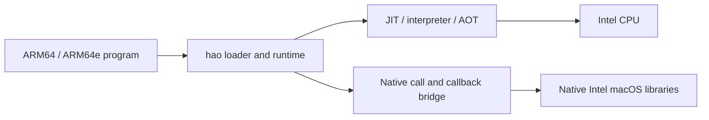

# Architecture

## Starting a program

An ARM-only executable reaches hao in one of two ways:

- **Routed.** The HaoExec kext gives the kernel an interpreter line,
  `#! /usr/libexec/hao --`, for an ARM-only Mach-O. The process is hao's; hao
  checks the guest's signature and then runs it.
- **Embedded.** `tools/hao-embed` adds an x86_64 slice, `hao-stub`, to the
  executable. The kernel starts that slice under the program's own path,
  signing identity and entitlements, and the stub runs the file's ARM slice
  through `libhao`.

The [security model](security-model.md) describes what each route preserves.

## Loading

`src/macho.c` validates and maps the guest's ARM slice and every ARM-only
library it loads, applies chained or legacy dyld fixups, and registers the
images with the native Objective-C and Swift runtimes. Imports of libraries
that exist natively bind directly to the x86_64 library.

Guest `__TEXT` is mapped non-executable. hao runs it in one of three modes:

- **JIT** (`src/jit.c`, `src/x86_emit.c`): translates basic blocks to x86_64,
  chains direct branches and keeps guest registers in a CPU structure.
  Instructions without a native translation call the interpreter as a helper.
- **Interpreter** (`src/a64_interp.c`, `src/a64_simd.c`, `src/a64_fp.c`): the
  reference implementation, checked against native ARM by the oracle tests.
- **AOT** (`include/hao/aot.h`): caches of translated code bound to the guest
  image's code (its cdhash) and the runtime that produced them, loaded only
  from trusted directories and validated before use
  ([security model](security-model.md#aot-caches)).

## Native boundary

A call from guest code to a native function, or from native code into guest
code, crosses between the ARM64 and x86_64 calling conventions. The bridge
(`src/bridge.c`, `src/bridge_x86_64.S`) moves arguments and results between
them using the best description available for that function:

- Objective-C type encodings, block signatures and Swift mangled names.
- Interface units: per-library tables, keyed by the native library's UUID,
  that describe exported functions. The format and its validation are in
  `include/hao/bridge.h`, `src/ifunit.c` and `tools/hao_ifunit.py`. Generated
  tables are compiled into the runtime or installed under `/usr/lib/hao/if`.
  The compiled-in tables (`src/NAME_gen.inc`) come from one macOS build,
  named with their format in `include/hao/gen_stamp.h`; their generators are
  not part of this repository. `hao -v` says when the running build differs.
- Conservative inference from the guest's own code where nothing else applies.

Each binding has a route: EXACT and TYPED describe how the call is placed;
UNKNOWN and REFUSED are explicit outcomes. A route describes ABI placement
only, not complete value, ownership or concurrency compatibility.

Native code calling back into the guest (blocks, function pointers,
Objective-C methods, Swift witnesses and async continuations) enters through
generated thunks, or by faulting on the non-executable guest page; both paths
convert the arguments the same way.

The command-line launcher and embedded stubs share `libhao`. Packaging tools
validate Mach-O identity, interface units and code signatures; they do not
infer contracts.
